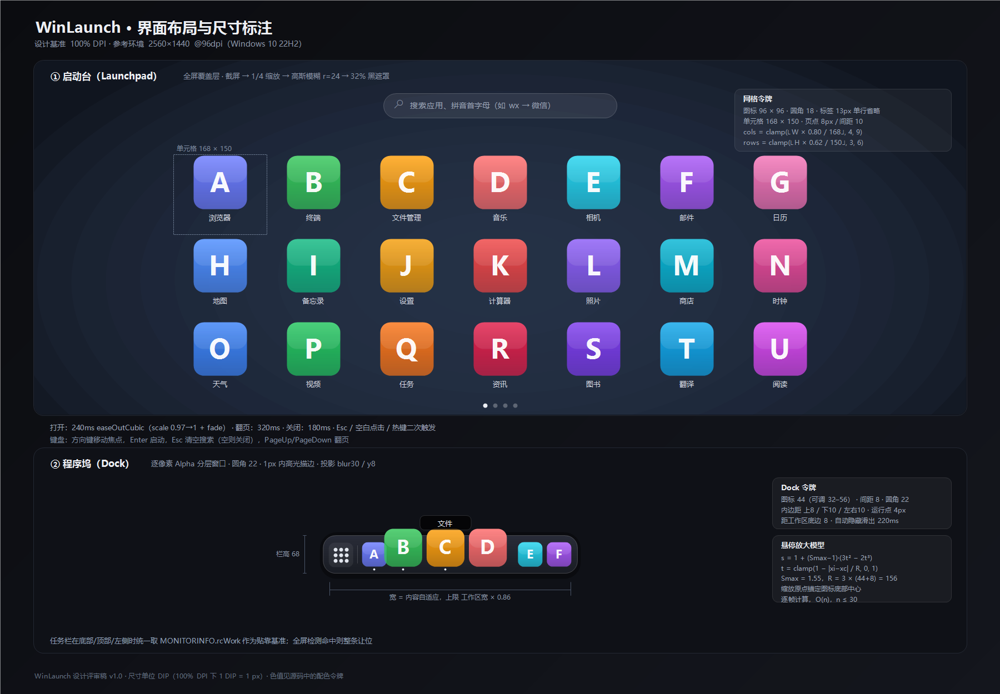

# WinLaunch

Windows 10/11 上的 macOS 式桌面增强：**启动台（Launchpad）+ 程序坞（Dock）**。

免安装、免管理员、不联网、卸载零残留。

> 状态：**v1.0.0**（单 exe 绿色版 + Inno 安装包；MIT 许可）



## 快速开始

从 [Releases](https://github.com/yaqisun1993-pixel/WinLaunch/releases) 下载安装包或绿色版，也可以自己编译：

```powershell
powershell -ExecutionPolicy Bypass -File build.ps1
```

> `build.ps1` 编译后默认部署到 `%LOCALAPPDATA%\Programs\WinLaunch`（`-DeployTo` 改目录，`-NoDeploy` 只编译不部署），然后运行该目录下的 `WinLaunch.exe`。
> `dist\run.cmd` 只是兼容入口。**建议从普通用户目录运行**，不要从只读或受限目录直接启动，否则程序可能写不了 `%APPDATA%`、启动的子程序也会带上权限限制。

- 屏幕底部出现程序坞；托盘出现 WinLaunch 图标
- `Ctrl + Alt + L` 打开启动台，`Ctrl + Alt + D` 显示/隐藏程序坞
- 托盘右键 → 退出

详细操作见 [使用说明](docs/使用说明.md)。

## 安装（普通用户）

| 文件 | 说明 |
|---|---|
| `WinLaunch-1.0.0-setup.exe` | 安装包，装到 `%LOCALAPPDATA%\Programs\WinLaunch`，带卸载器（可一并清配置/缓存） |
| `WinLaunch-1.0.0-portable.zip` | 绿色版，解压双击 `WinLaunch.exe` 即用，不写注册表 |

两个文件都附带在 [GitHub Releases](https://github.com/yaqisun1993-pixel/WinLaunch/releases) 里，并提供 `SHA256SUMS.txt`。版本更新与卸载说明见 [发布说明](docs/发布说明.md)。

## 已实现

| 模块 | 能力 |
|---|---|
| 启动台 | 全屏覆盖、实时背景虚化、自适应 9×5 网格、分页、搜索（名称 + 拼音/英文首字母）、键盘导航、点击启动、拖拽到 Dock、**常用行（自动记录高频应用）** |
| 程序坞 | 半透明圆角条、悬停放大（1.55×）、运行指示点、运行中应用动态显示（固定/临时分组竖线）、单击启动/切窗/最小化、拖拽排序、拖入钉住、拖出移除、深色圆角右键菜单、自动隐藏、全屏抑制 |
| 图标 | 四级降级提取（IShellItemImageFactory 256 → Jumbo → 32 → 字母色块）+ 内存 LRU + 磁盘 PNG 缓存 |
| 应用清单 | 开始菜单 `.lnk` + UWP（`Get-StartApps`）+ 系统项，中文拼音排序 |
| 系统集成 | 托盘菜单、全局热键、单实例、启动去重、开机自启、便携模式回退、配置原子写入与备份回滚 |
| 健壮性 | 全局限异常捕获、日志、图标线程 STA 隔离（避免 Shell API 在 MTA 下挂死） |

## 技术要点

- **框架**：WPF + .NET Framework 4.8（Windows 10 内置），`csc.exe` 直接编译，**无需 .NET SDK**，产物约 131 KB 单文件。
- **透明窗口**：逐像素 Alpha 分层窗口；启动台用"截屏 → 1/4 缩放 → 高斯模糊 → 放大 4×"实现背景虚化，不依赖未文档化 API。
- **悬停放大**：`s = 1 + 0.55·(3t²−2t³)`，逐帧插值、`RenderTransform` 布局（不触发 Measure/Arrange）。
- **图标**：Shell 图标 API 必须跑在 **STA** 线程——放在线程池（MTA）会静默挂死，这是实现期踩到的最大坑。

## 目录

```
src/                    源码（UI 全代码构建，无 XAML）
  AssemblyInfo.cs       产品信息（版本号由 build.ps1 生成，不在此处硬编码）
assets/app.ico          应用图标（脚本生成）
build.ps1               构建脚本（调用系统 csc；-Release 出发布包）
installer/WinLaunch.iss Inno Setup 6 安装包脚本（单用户安装，可清数据卸载）
dist/                   兼容入口：run.cmd
docs/                   使用说明与发布说明
docs/images/            界面布局与尺寸标注图
tools/                  图标生成、设计图生成脚本
```

## 已知限制

多显示器仅铺主屏、混合 DPI 未逐屏适配、UWP 磁贴类图标偏素、部分拖拽交互仅人工验证。

详见 [使用说明 · 已知限制](docs/使用说明.md)。

## 从源码构建

```powershell
powershell -ExecutionPolicy Bypass -File build.ps1
# 自定义部署目录 / 不部署：
powershell -ExecutionPolicy Bypass -File build.ps1 -DeployTo 'D:\Apps\WinLaunch'
powershell -ExecutionPolicy Bypass -File build.ps1 -NoDeploy
# 出发布包（exe + 绿色版 zip + 安装包 + SHA256SUMS）：
powershell -ExecutionPolicy Bypass -File build.ps1 -Release -Version 1.0.0
```

依赖：Windows 10+ 自带的 .NET Framework 4.8 与 `C:\Windows\Microsoft.NET\Framework64\v4.0.30319\csc.exe`。
出安装包还需要 [Inno Setup 6](https://jrsoftware.org/isdl.php)（`ISCC.exe`），未安装时会跳过安装包、只出绿色版。

`-Release` 默认把发布包写到 **`%USERPROFILE%\WinLaunch-release\WinLaunch-<版本>\`**（`-ReleaseDir` 可改）。

## 代码签名策略 / Code signing policy

WinLaunch 采用 MIT 许可开源发布。发布包使用 [SignPath.io](https://about.signpath.io) 提供的免费代码签名服务，
证书由 [SignPath Foundation](https://signpath.org) 签发：

> Free code signing provided by [SignPath.io](https://about.signpath.io), certificate by [SignPath Foundation](https://signpath.org).

- **签名范围**：`WinLaunch.exe`、`WinLaunch-<版本>-setup.exe`，全部由本仓库源码在 GitHub Actions 中自动构建后签名
- **角色与成员**（当前为单人维护，均在 [@yaqisun1993-pixel](https://github.com/yaqisun1993-pixel) 名下）：
  - Authors（提交者）：[@yaqisun1993-pixel](https://github.com/yaqisun1993-pixel)
  - Reviewers（审核者）：[@yaqisun1993-pixel](https://github.com/yaqisun1993-pixel)
  - Approvers（签名批准者）：[@yaqisun1993-pixel](https://github.com/yaqisun1993-pixel)
- **隐私政策**：本程序不会向其他联网系统发送任何信息，除非用户或安装者主动要求。
  程序只读写本机文件（`%APPDATA%\WinLaunch`、`%LOCALAPPDATA%\WinLaunch`）和注册表的开机自启项，**没有任何网络请求**。
- **文档意愿**：代码签名证书由 SignPath Foundation 以自身名义签发；若本项目的签名被滥用，SignPath Foundation 有权撤销。

## 许可

[MIT](LICENSE) © 2026 yaqi
